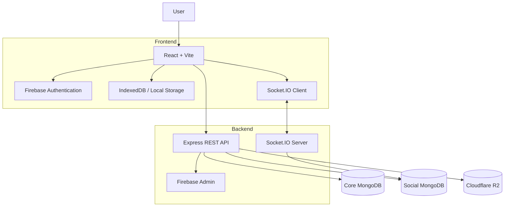

<div align="center">

# StudyOS

### Plan. Focus. Study together.

A full-stack study platform for productivity, deep work,
progress tracking, and collaborative learning.

Manage your tasks, organize notes, track study sessions,
and collaborate with others in one connected workspace.

<br />

[](https://studyos37.space)
[](https://github.com/Vaibh37/Studyos/releases)
[](./LICENSE)

<br />


</div>

---

## Overview

StudyOS is an open-source study management platform
designed to help users organize their work and maintain
consistent study habits.

It combines productivity tools and collaborative features
within a unified workspace.

Users can manage tasks, subjects, notes, calendar events,
focus sessions, and study statistics without switching
between multiple applications.

StudyOS also supports collaborative study rooms,
real-time messaging, and optional weekly competition.

**Live website:** https://studyos37.space

---

## What's New in V4

StudyOS v4 introduces major improvements to mobile
usability, interface design, and daily engagement.

### Redesigned Dashboard

The dashboard now provides a more focused overview
of daily study activity.

Improvements include:

- Focus-first mobile experience
- Compact daily Focus progress
- Improved XP and level indicators
- More accessible streak information
- Simplified task summaries
- Upcoming event previews
- Improved typography and spacing
- Reduced unnecessary scrolling
- Responsive desktop and mobile layouts

### Redesigned Notes Workspace

The Notes interface has been redesigned around
a visual card-based library.

Features include:

- Grid-based note organization
- Masonry-style note cards
- Note content previews
- Pinned notes
- Subject linking
- Subject color indicators
- Search and filtering
- Sorting controls
- Mobile note editor
- Save and delete actions

The mobile interface separates note browsing
from note editing.

### Improved Study Groups

Study Groups now provide a more structured
experience for creating and joining rooms.

Improvements include:

- Updated group creation interface
- Dedicated invitation-code entry
- Public and private group options
- Improved mobile forms
- Responsive room management
- Group member information
- Group study activity
- Group-specific leaderboards
- Easier navigation between rooms and chats

### Animated Daily Streaks

StudyOS v4 introduces daily visit streak tracking.

Features include:

- Automatic daily check-ins
- Consecutive-day tracking
- Animated flame indicator
- Layered SVG flame movement
- Full-screen streak celebrations
- Interactive animation replay
- Best-streak tracking
- Guest streak persistence
- Account-based streak persistence

The streak celebration appears when a daily
check-in is recorded and returns to a compact
indicator in the top-right corner.

Daily visit streaks are separate from
Focus-based study streaks.

Opening the application does not award study XP.

### Interface Improvements

V4 also introduces broader visual improvements:

- Consistent typography
- Standardized spacing
- More compact layouts
- Improved button and form styling
- Cleaner empty states
- Improved mobile navigation
- Better responsive behavior
- Reduced visual clutter
- More consistent dark-theme styling

### New Domain

StudyOS is now available through its own domain.

**https://studyos37.space**

---

## Features

### Dashboard

The dashboard brings important study information
into one place.

- Daily focus time
- Focus goals
- Level progression
- XP tracking
- Study streaks
- Daily visit streaks
- Pending tasks
- Upcoming events
- Quick navigation

### Task Management

Manage study tasks and track their completion.

- Create, edit, and delete tasks
- Set priorities
- Assign subjects
- Add due dates
- Mark tasks complete
- Search and filter tasks
- View task deadlines in Calendar

### Subjects

Organize study material by subject.

- Custom subject names
- Subject colors
- Descriptions
- Linked tasks
- Linked notes
- Subject-specific statistics

### Notes

Save and organize study information.

- Create and edit notes
- Grid-based note library
- Content previews
- Pin important notes
- Link notes to subjects
- Search and filter
- Sort by different properties
- Responsive mobile editor

### Calendar

Manage scheduled work and review previous activity.

- Monthly calendar
- Custom events
- Task deadlines
- Selected-date details
- Study session history
- Event management

### Focus Timer

Track meaningful study sessions.

- Preset durations
- Custom session durations
- Subject selection
- Pause and resume
- Timer persistence
- Session history
- Focus statistics

### Progress Tracking

Review study activity over time.

- Focus duration
- Completed tasks
- Weekly activity
- Subject distribution
- XP progression
- Study consistency
- Study streak history

### Global Leaderboard

StudyOS provides optional weekly competition.

- Weekly rankings
- Study-based scoring
- Public display names
- Weekly XP
- Focus statistics
- Opt-in participation
- Privacy controls

Users can keep their leaderboard profiles private.

---

## Study Groups

Study Groups provide shared spaces for collaborative
learning.

### Group Management

- Create study groups
- Join using invitation codes
- Public groups
- Private groups
- Group descriptions
- Group ownership
- Member lists
- Group activity
- Group leaderboards

### Real-Time Study Presence

Socket.IO enables real-time communication
between connected users.

Group members can view active shared Focus sessions.

### Real-Time Chat

StudyOS provides messaging inside study groups.

Features include:

- Instant messaging
- Message replies
- Reply previews
- Message reactions
- Typing indicators
- Message grouping
- Read-state handling
- Message deletion controls
- Responsive chat layouts

### File Attachments

StudyOS supports file attachments through
Cloudflare R2.

The backend handles:

- Upload authorization
- Signed upload URLs
- File verification
- Attachment metadata
- Signed download URLs

File storage is managed separately from
the primary application database.

---

## Gamification

StudyOS uses progress indicators to encourage
consistent learning.

### XP and Levels

Qualifying study activity contributes to XP
and level progression.

Examples include:

| Activity | XP |
| --- | ---: |
| Focus session | 1 XP per minute |
| Completed task | 15 XP |
| Eligible priority tasks | Additional bonus |
| Eligible study streak activity | Streak rewards |

XP also contributes to eligible leaderboard scores.

### Study Streak vs Daily Visit Streak

StudyOS maintains two separate streak systems.

| Study Streak | Daily Visit Streak |
| --- | --- |
| Based on study activity | Based on daily visits |
| Encourages productive work | Encourages consistency |
| Connected to study progress | Connected to daily check-ins |
| Part of study gamification | Separate activity indicator |

Daily visit streaks do not automatically
increase XP or study time.

---

## Authentication

StudyOS supports two usage modes.

### Guest Mode

Users can access core study tools
without creating an account.

Guest data is stored locally.

- Study data uses IndexedDB
- Visit streaks use local storage
- Guest data remains tied to the browser
  unless migrated through a supported workflow

### Account Mode

Firebase Authentication is used for
registered users.

Supported authentication methods include:

- Google
- Email and password

Authenticated application data is managed
through the StudyOS backend and MongoDB.

Signed-in users can access account-based
features and real-time collaboration tools.

---

## Technology Stack

### Frontend

| Technology | Purpose |
| --- | --- |
| React 19 | Interface development |
| JavaScript / JSX | Application logic |
| Vite 8 | Development and builds |
| React Router | Navigation |
| CSS | Responsive styling |
| Lucide React | Icons |
| Firebase SDK | Authentication |
| Socket.IO Client | Real-time communication |
| IndexedDB | Guest study data |
| SVG animations | Streak flame animation |

### Backend

| Technology | Purpose |
| --- | --- |
| Node.js | JavaScript runtime |
| Express 5 | REST API |
| MongoDB Atlas | Application databases |
| Mongoose | Database models |
| Firebase Admin | Authentication verification |
| Socket.IO | Real-time communication |
| Cloudflare R2 | File storage |
| AWS SDK for S3 | R2 integration |
| express-rate-limit | API rate limiting |

### Infrastructure

| Service | Purpose |
| --- | --- |
| Vercel | Frontend hosting |
| Render | Backend hosting |
| MongoDB Atlas | Database hosting |
| Firebase | Authentication |
| Cloudflare R2 | Attachment storage |
| studyos37.space | Custom domain |

---

## Architecture



The frontend is deployed on Vercel.

The backend runs on Render.

MongoDB Atlas provides persistent database storage,
and Cloudflare R2 handles file attachments.

---

## Repository Structure

```text
Studyos/
|
|-- client/
|   |-- src/
|   |   |-- components/
|   |   |-- context/
|   |   |-- hooks/
|   |   |-- pages/
|   |   |-- services/
|   |   |-- styles/
|   |   |-- App.jsx
|   |   `-- main.jsx
|   |
|   `-- package.json
|
|-- server/
|   |-- config/
|   |-- middleware/
|   |-- models/
|   |-- routes/
|   |-- services/
|   |-- socket/
|   |-- utils/
|   |-- server.js
|   `-- package.json
|
|-- docs/
|   `-- screenshots/
|
|-- .gitignore
|-- LICENSE
|-- NOTICE
`-- README.md
```

---

## Local Development

### Prerequisites

- Node.js 20.19 or later
- npm
- Git
- MongoDB configuration
- Firebase configuration
- Cloudflare R2 configuration for attachments

### Clone Repository

```bash
git clone https://github.com/Vaibh37/Studyos.git
cd Studyos
```

### Install Dependencies

Frontend:

```bash
cd client
npm ci
```

Backend:

```bash
cd ../server
npm ci
```

On Windows PowerShell, use `npm.cmd`
if execution policies block `npm.ps1`.

### Frontend Environment

Create `client/.env`.

```env
VITE_API_URL=http://localhost:5000

VITE_FIREBASE_API_KEY=your_api_key
VITE_FIREBASE_AUTH_DOMAIN=your_auth_domain
VITE_FIREBASE_PROJECT_ID=your_project_id
VITE_FIREBASE_STORAGE_BUCKET=your_storage_bucket
VITE_FIREBASE_MESSAGING_SENDER_ID=your_sender_id
VITE_FIREBASE_APP_ID=your_app_id
```

### Backend Environment

Create `server/.env`.

```env
PORT=5000

MONGO_URI=your_mongodb_uri
MONGO_SOCIAL_URI=your_social_mongodb_uri

FRONTEND_URL=http://localhost:5173

FIREBASE_PROJECT_ID=your_project_id
FIREBASE_CLIENT_EMAIL=your_service_account_email
FIREBASE_PRIVATE_KEY="your_private_key"

R2_REGION=auto
R2_ENDPOINT=your_r2_endpoint
R2_ACCESS_KEY_ID=your_r2_access_key
R2_SECRET_ACCESS_KEY=your_r2_secret_key
R2_BUCKET_NAME=your_bucket_name
```

Never commit environment files containing credentials.

### Start Backend

```bash
cd server
npm run dev
```

Default local API:

```text
http://localhost:5000
```

### Start Frontend

Open another terminal:

```bash
cd client
npm run dev
```

Default frontend:

```text
http://localhost:5173
```

### Production Build

```bash
cd client
npm run build
```

The production frontend is generated in `client/dist`.

---

## API

StudyOS uses REST endpoints for its
main application features.

```text
/api/auth
/api/tasks
/api/subjects
/api/notes
/api/events
/api/study-sessions
/api/leaderboard
/api/groups
/api/health
/api/status
/api/uptime
```

Daily visit tracking uses:

```http
POST /api/auth/streak/check-in
```

Authenticated requests are verified through
Firebase authentication.

Real-time study presence and group messaging
use Socket.IO.

---

## Security and Privacy

StudyOS includes security controls across
authentication, data access, and communication.

- Firebase authentication
- Backend identity verification
- User-scoped data access
- Configurable CORS
- API rate limiting
- Socket message rate limiting
- Authorized file uploads
- Signed attachment URLs
- Private group access controls
- Optional leaderboard participation

Private study content is not intended
for public leaderboard display.

Security improvements and testing remain
ongoing development priorities.

---

## Deployment

**Production website:** https://studyos37.space

### Frontend

Deployed using Vercel.

The production frontend is connected
to the GitHub repository.

### Backend

Hosted using Render.

The backend provides:

- REST API
- Database operations
- Socket.IO connections
- Authentication verification
- File attachment operations
- Daily streak persistence

### Supporting Services

- MongoDB Atlas
- Firebase Authentication
- Cloudflare R2

Production environment variables are configured
separately for each hosting service.

---

## Development History

| Version | Main Focus |
| --- | --- |
| V1 | Initial study management |
| V2 | Expanded productivity workspace |
| V3 | Real-time collaboration and Study Groups |
| V4 | Mobile redesign, improved Notes, group UX, and daily streaks |

---

## Roadmap

Future development areas include:

- [ ] Automated frontend testing
- [ ] Automated backend testing
- [ ] End-to-end testing
- [ ] Accessibility improvements
- [ ] Performance optimization
- [ ] Additional group management tools
- [ ] Expanded study analytics
- [ ] Mobile experience improvements
- [ ] PWA support
- [ ] Updated screenshots and documentation

### Future Premium Features

StudyOS may introduce optional commercial
features in future releases.

Possible areas include:

- Premium themes
- Additional personalization
- Advanced analytics
- Additional productivity tools

The core open-source application can remain
available while separately developed premium
components use different license terms.

Premium features are not part of the
current v4 release unless separately announced.

---

## Open Source and Commercial Use

StudyOS Core is distributed under the
Apache License, Version 2.0.

The Apache 2.0 license permits:

- Personal use
- Commercial use
- Modification
- Distribution
- Private use
- Redistribution under the license terms

Users must comply with the conditions
of the Apache License 2.0.

This includes preserving required copyright
and license notices and identifying modified files
when distributing changes.

The license does not grant unrestricted rights
to third-party intellectual property or trademarks.

### Commercial Development

StudyOS may offer paid services or premium
features in the future.

The open-source license does not prevent
the project owner from commercializing StudyOS.

Future proprietary modules, services, and
premium assets may be distributed under
separate terms.

Code already released under Apache 2.0
remains subject to that license.

---

## License

Copyright 2026 Vaibh37.

Licensed under the
[Apache License, Version 2.0](./LICENSE).

See the [LICENSE](./LICENSE) file for the
complete legal terms.

See [NOTICE](./NOTICE) for project attribution.

Third-party libraries, images, and other assets
remain subject to their respective licenses.

The Apache License 2.0 does not grant
trademark rights to the StudyOS name
or branding.

---

## Contributing

Contributions, issue reports, and suggestions
are welcome.

When submitting contributions:

1. Explain the problem or feature.
2. Keep changes focused.
3. Avoid committing credentials or private data.
4. Follow the existing project structure.
5. Test relevant functionality before submitting.
6. Ensure submitted code can be distributed
   under the repository license.

Contributions are reviewed before merging.

---

## Releases

Versioned releases are published through GitHub.

[View GitHub Releases](https://github.com/Vaibh37/Studyos/releases)

---

## Author

<div align="center">

### Built by Vaibh37

An independent software project focused on
building a connected study experience.

[GitHub](https://github.com/Vaibh37) |
[StudyOS](https://studyos37.space)

<br />

**If you find StudyOS useful, consider starring the repository.**

### Plan. Focus. Study together.

</div>
